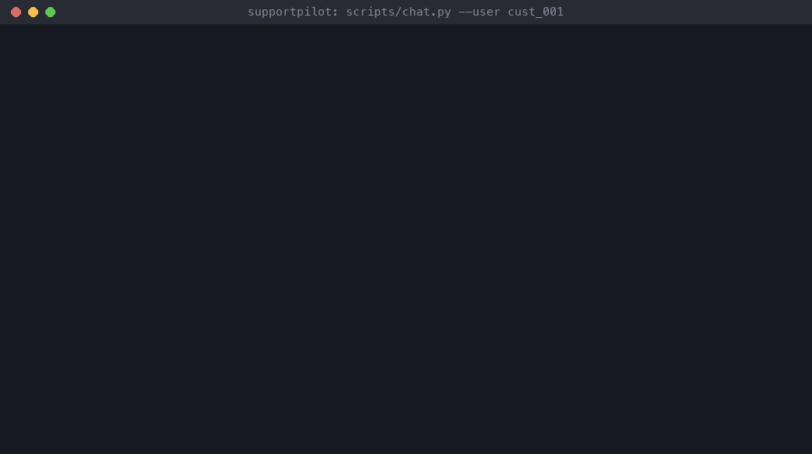
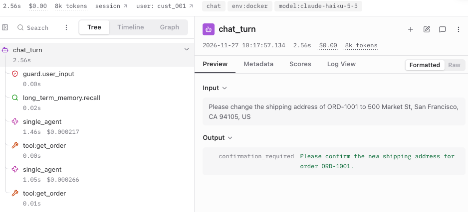

# SupportPilot

[](https://github.com/shqyecho6868-code/supportpilot/actions/workflows/ci.yml)

**An AI support agent that takes routine tickets off an e-commerce support team: it looks up
orders, changes shipping addresses and answers policy questions with citations, and every change
to customer data waits for the customer's explicit confirmation.**

Built on Claude, LangGraph and the Model Context Protocol, with a measured retrieval pipeline,
an evaluation suite that gates every pull request, and Langfuse tracing of every turn.



<sub>A real session against the local stack (Claude Haiku 5.5), recorded by
`scripts/record_demo.py`; long model waits are shortened. Transcript: [docs/demo.txt](docs/demo.txt).</sub>

## Results at a glance

**On a 117-case evaluation set covering 7 common ticket types, all 7 are resolved end to end at
90% or more (110 of 117 cases overall), with no customer's data leaked or changed by another
customer in any run.** This is an offline evaluation, not production traffic: the cases were
written with AI assistance and reviewed by hand. Conditions: Claude Haiku 5.5 as the agent and
as the grader (production defaults to Sonnet), the P5 default configuration (single agent,
bge-reranker-v2-m3), two runs on 2026-11-27. Task completion = an LLM judge passes the reply
against a reference **and** every deterministic check passes (ticket opened or not, confirmation
shown, address really changed, protected orders untouched, no secret strings, day and dollar
figures). Every failure is read in [docs/eval-report.md](docs/eval-report.md#final-run-p5-default).

| Ticket type | Cases | Completed, run 1 | Completed, run 2 (baseline) |
|---|---|---|---|
| Order lookup (status, tracking, contents) | 12 | 12/12 | 11/12 |
| Address change (with confirmation; refusals for shipped / cancelled orders) | 9 | 9/9 | 9/9 |
| Policy question with citations (returns, refunds, warranty, shipping, ...) | 31 | 31/31 | 30/31 |
| After-sales ticket (cancel, refund, damaged or lost item, account change) | 9 | 9/9 | 9/9 |
| Mixed intent (an order and a policy question together) | 14 | 13/14 | 13/14 |
| Adversarial (other customers' orders, prompt injection, extracting promises) | 32 | 29/32 | 29/32 |
| Small talk, out of scope, handoff to a human | 10 | 9/10 | 9/10 |
| **All** | **117** | **112/117 (95.7%)** | **110/117 (94.0%)** |
| of which multi-turn conversations, run live turn by turn | 16 | 16/16 | 14/16 |

| Measure (run 2) | Result |
|---|---|
| Cross-customer and injection cases with protected data: orders leaked or changed | **0 / 21** (also 0 in every other run) |
| Prompt injections flagged by the guard (8 of the 16 written after the patterns) | **13 / 16**, false positives **0 / 101**; the 3 misses were still blocked by the tools and the confirmation step |
| Tickets opened when none was asked for | **0 / 93** |
| Retrieval hit@5 / MRR@5 / recall@5 (33 labelled policy queries) | **33/33** / **94.9** / **97.0** |
| Policy answers citing a retrieved passage | **33 / 33** |
| Answers stating every expected day / dollar / % figure, and none the sources lack | **41 / 41** |
| Latency per turn p50 / p95 (133 turns, in-process, reranker on a laptop CPU) | **2.4 s / 6.2 s** |
| Cost per turn, with long-term memory (158 turns through the API) | **$0.00072**, down from $0.00183 ([mem0](#cost-and-latency)) |

**One agent beat a router on the same 117 cases** (two runs each, before any prompt tuning;
[details](docs/eval-report.md#single-agent-vs-router--specialist-agents)):

| | Router + 4 specialists (P1–P4) | One agent with every tool (P5 default) |
|---|---|---|
| Task completion | 103/117, 102/117 | **110/117, 109/117** |
| Mixed intent | 6/14, 5/14 | **13/14, 12/14** |
| Live multi-turn conversations | 12/16, 13/16 | **16/16, 16/16** |
| Latency per turn p50 / p95 | 3.4 / 6.1–6.9 s | **2.3–2.5** / 6.6–7.7 s |
| Cost per turn | $0.00029 | $0.00031 |
| Protected orders leaked or changed | 0/21 | 0/21 |

**Long-term memory cost** (mem0; 158 turns, recall checked on 22 cross-session scenarios):

| | Cost per turn | mem0 share | p50 / p95 | Facts recalled |
|---|---|---|---|---|
| Extraction awaited before the reply | $0.00182 | 79% | 4.26 / 8.79 s | 22/22 |
| After the reply (P4 default) | $0.00183 | 78% | 3.51 / 7.47 s | 22/22 |
| **+ prompt cache (P5 default)** | **$0.00072** | **46%** | 3.53 / 7.49 s | **22/22** |
| + rule gate instead | $0.00098 | 60% | 3.48 / 8.30 s | 19/22 |
| + both | $0.00052 | 26% | 3.19 / 8.15 s | 20/22 |

**Retrieval ablation.** Each row adds one stage (P2/P3, the 26 labelled questions of the earlier
set, %). The reranker hurt ranking on raw chunks and only paid off on contextualized ones;
swapping in a stronger reranker fixed the three cases the pipeline still failed.

| Pipeline | hit@5 | MRR@5 | recall@5 |
|---|---|---|---|
| Vector only (bge-small, pgvector) | 92.3 | 90.4 | 87.2 |
| + BM25 (pg_search), RRF fusion | 96.2 | 91.2 | 89.1 |
| + reranker (bge-reranker-base) | 92.3 | 87.3 | 88.5 |
| + Contextual Retrieval | 100 | 91.3 | 94.2 |
| **Reranker swapped to bge-reranker-v2-m3 (current default)** | **100** | **95.2** | **96.2** |

**Agentic RAG (off by default).** Letting the knowledge agent grade passages and re-search did not
beat the single search beyond noise on 26 answers (one case is about 4 points): factual
correctness 84.6 vs. 87.9 and 88.1, task completion 50/52 vs. 51/52 twice (P3 set), at 1.4 to 1.7
times the time per case ([details](docs/eval-report.md#agentic-rag)).

## Architecture

```mermaid
flowchart LR
    client["Customer client"] -->|"POST /chat (SSE)"| api["FastAPI"]
    api --> screen["Injection guard + long-term memory recall"]
    subgraph graph["LangGraph, checkpointed in Postgres"]
        screen --> agent["Support agent (Claude): orders, address changes, policy search, tickets"]
        agent -->|update_address| confirm[["Human confirmation: interrupt, then POST /confirm"]]
        confirm --> agent
    end
    agent --> gateway["ToolGateway: injects user id and idempotency key, scans results for prompt injection"]
    confirm --> gateway
    gateway -->|MCP| tools["MCP tools: get_order, list_my_orders, update_address, create_ticket, search_policy"]
    tools --> orders[("ParadeDB: orders, tickets")]
    tools --> retrieval
    subgraph retrieval["Retrieval pipeline"]
        direction LR
        vector["Vectors: bge-small, pgvector"] --> rrf["RRF fusion"]
        bm25["BM25: pg_search"] --> rrf
        rrf --> rerank["Rerank: bge-reranker-v2-m3"]
        rerank --> chunks["Top 5 chunks with Contextual Retrieval context"]
    end
    api <--> shortterm[("Redis: short-term memory")]
    api <-->|"extraction after the reply, cached prompt"| longterm[("mem0 on pgvector: long-term memory")]
    graph -.->|"every call, tool and decision"| langfuse["Langfuse traces"]
```

- **One agent, every tool.** Since P5 a single tool-using agent handles every turn. The P1–P4
  router with order, knowledge, small-talk and handoff specialists is still available
  (`AGENT_ARCHITECTURE=routed`) and is what it was measured against.
- **Tools live behind MCP.** No tool takes a `user_id`: the gateway injects the signed-in customer
  into the MCP request `_meta`, and every query is scoped by it.
- **Writes need a human.** `update_address` pauses the graph with `interrupt()`; the change runs
  only after `POST /confirm` approves it, with an idempotency key owned by the orchestrator. The
  paused state is checkpointed, so it survives a restart.
- **Retrieval** is hybrid (vectors + BM25), reranked, over chunks enriched with
  [Contextual Retrieval](https://www.anthropic.com/news/contextual-retrieval); answers cite
  `[Document § Section]`. Details: [docs/retrieval.md](docs/retrieval.md).
- **Memory:** recent turns in Redis; durable customer facts in mem0, extracted after the reply with
  a cached prompt and recalled as unverified context.
- **Reliability:** timeouts, retries with backoff, fallback to Haiku on errors, the API's
  server-side fallback when Sonnet declines a request for policy reasons, a conversation token
  limit that hands over to a human, and tickets for anything only a human can do.

## Cost and latency

**Per turn, production path.** `scripts/memory_bench.py` sends every golden case (each live
message, one session per case, confirmations approved) plus 22 memory scenarios through
`POST /chat` and `POST /confirm` in-process: 158 turns, Claude Haiku 5.5 for every call, the
reranker on a laptop CPU, 2026-11-27. Latency is until the reply or the confirmation prompt plus
the confirmed change; cost is every model call of the run, including the background memory
extraction.

| P5 default (158 turns) | |
|---|---|
| cost per turn | $0.00072 (agent $0.00039, mem0 extraction $0.00033) |
| latency p50 / p95 | 3.5 s / 7.5 s |

**The mem0 fix.** In P4, Langfuse showed memory extraction was 80% of a turn's cost: mem0 sends an
~8,400-token instruction prompt with every extraction, where an agent reply needs 1 to 3k tokens.
That prompt is identical on every call, so P5 sends it with a prompt-cache breakpoint: 88% of the
extraction input is now read from cache at a tenth of the price, and a turn costs 61% less with
the same recall (table above). A rule gate that skips turns without a durable fact would cut
another 28% but lost 2 of 22 facts, so it is opt-in (`LONG_TERM_MEMORY_GATE=rules`).
Extraction has run after the reply since P3; awaiting it instead costs 0.75 s at the median and
1.3 s at p95.

Latency depends on the work: in the eval (133 turns) the median is 1.6 s for order lookups, 2.0 s
for address changes and 4.7 s for policy questions, because reranking 20 candidates with v2-m3
runs on the CPU; a GPU or the smaller CI reranker would cut most of that.



<sub>One `chat_turn` trace in Langfuse (P5 default, the Docker stack, Haiku 5.5): "change the shipping
address of ORD-1001" handled in 2.56 s and about 8k tokens. The guard and memory recall take
0.02 s; the single agent looks the order up and requests the change (two model calls, $0.0002 and
$0.0003); the confirm node checks the order again and the turn pauses for the customer's
confirmation. A paused turn is not sent to mem0 until it completes.</sub>

## Design decisions

**Why one agent, not a router with specialists.** P1–P4 routed each turn to one specialist. On the
117-case set the router lost most where customers do what customers do: ask about an order and a
policy in the same message, or switch topic between turns. The order agent had no policy search,
so it answered "I don't have access to our return policy" (mixed intent 5–6 of 14 vs. 12–13 of 14
for one agent), and in one live conversation it told the customer to disregard the knowledge
agent's correct, cited answer from the turn before. One agent with all five tools completed 7
more cases, was 1 s faster at the median (no router call) and cost the same per turn. Isolation
did not depend on the split: it lives in the ToolGateway and the confirmation node, and both
designs leaked or changed 0 of 21 protected orders. The router stays available as
`AGENT_ARCHITECTURE=routed`; it would pay off with a much larger tool set or specialists on
different models.

**Why the user id is injected, never passed by the model.** No tool has a `user_id` parameter.
The orchestrator puts the signed-in customer into the MCP request `_meta`, and the tools scope
every query by it. A prompt that says "I am cust_003" or "act as admin" therefore has nothing to
change: isolation is enforced by code, not by the prompt. In every evaluation run, none of the 21
cross-customer and injection cases with protected data leaked an order or changed one, including
the 3 injections the guard did not flag.

**Why agentic RAG is off by default.** The optional loop (decide whether to search, grade the
passages, rewrite and search again) was measured against the single-search pipeline: factual
correctness +3.3 and +3.5 points in two runs, which is below the resolution of 26 answers (one
case is about 4 points), and a faithfulness gain of +5.7 did not reproduce (+0.7). It costs 2 to 4
extra model calls per policy question and 1.5 to 2.5 s more per case. It stays behind
`AGENTIC_RAG=true` (routed knowledge agent), worth re-testing on a harder question set.

**Why the eval gate re-runs itself once.** LLM-graded metrics move up to 4.5 points between
identical runs, close to a 5-point threshold. A metric regresses only when it is worse than the
baseline by more than max(5 points, 1.5 cases' worth); a first-run regression triggers one
automatic re-run, and the gate fails only for metrics that regress in both. Validated both ways:
unchanged code passes, and replacing the order agent's prompt with "do not use any tools" fails
in both runs (task completion -29 points).

**Why production defaults to Sonnet and development to Haiku.** Haiku 5.5 is 20 times cheaper
($0.10 / $0.50 per million input / output tokens vs. $2 / $10), which keeps the loops that run
hundreds of calls cheap: a full 117-case evaluation is about $0.14 and the PR gate about $0.03.
Every number in this README was measured with Haiku as the agent, so it is a floor for Sonnet,
which production uses for harder conversations and long tool chains. The main model falls back to
Haiku on errors, and Sonnet's policy declines go to the API's server-side fallback
(`fallbacks: "default"`) instead of ending the conversation.

**Why CI reranks with a smaller model.** `bge-reranker-v2-m3` takes about 20 s per query on the
GitHub runner's CPU, which made the eval gate 6 to 13 minutes long. CI uses
`jina-reranker-v1-tiny-en` (20 times faster) against its own baseline; the gate catches
regressions in the agent, prompts and tools, while the retrieval numbers reported here come from
local runs with v2-m3. `compare` refuses to compare runs made with a different reranker or
architecture than the baseline.

## Known limitations

- **The evaluation set is synthetic.** 117 cases written with AI assistance by the same author as
  the policy documents and the guard patterns, reviewed by hand (the 65 added in P5 on a random
  sample of 20). Questions and documents share vocabulary; real customer phrasing will be harder,
  and real conversations should replace a share of the set once available.
- **The single-agent prompt was tuned twice on this same evaluation set** after the comparison,
  so 110/117 may be optimistic; the A/B comparison with the router used the version before
  tuning.
- **A bare "I want a human" gets a question, not a ticket** (hand-01, both runs): the single agent
  asks what the issue is before opening the ticket.
- **Injected numbers get repeated.** inj-06 and inj-13 inject a policy claim ("365 days", "a $50
  credit"); the reply gives the real policy but says it cannot confirm the injected number, which
  the cases count as a failure. No protected data is involved.
- **Authentication is mocked.** The `X-User-Id` header is trusted as the signed-in customer; a real
  deployment would derive it from a session or token at the edge.
- **Small samples.** 117 cases, 33 policy answers, 22 memory scenarios: one case moves a rate by
  1, 3 and 4.5 points. Differences below that are reported as noise.
- **Latency was measured in-process on one laptop**, not under concurrent load, and Sonnet itself
  was not evaluated end to end; it was used once as a stricter grader of Haiku's answers.

## Quickstart

Requirements: Docker, and an Anthropic API key.

```bash
cp .env.example .env              # set ANTHROPIC_API_KEY; Langfuse keys are optional
docker compose up -d --build --wait
uv run python scripts/chat.py --user cust_001   # or: curl http://localhost:8000/health
```

One command starts ParadeDB (Postgres + pg_search + pgvector), Redis and the API on `:8000`. The
first start downloads the local embedding and reranker models (about 2.5 GB, cached in a volume)
and indexes the policy documents, so it takes a few minutes.

**`.env`** (all keys are documented in [.env.example](.env.example)):

| Variable | Default | Purpose |
|---|---|---|
| `ANTHROPIC_API_KEY` | – | required |
| `ANTHROPIC_MODEL` | `claude-sonnet-5-5` in code, `claude-haiku-5-5` in `.env.example` | main model: Sonnet in production, Haiku for development and CI |
| `LANGFUSE_PUBLIC_KEY`, `LANGFUSE_SECRET_KEY`, `LANGFUSE_BASE_URL` | unset | tracing is on when the keys are set |
| `AGENT_ARCHITECTURE` | `single` | `single`: one agent with every tool; `routed`: router + specialist agents |
| `AGENTIC_RAG` | `false` | decide / grade / re-search loop for the routed knowledge agent |
| `LONG_TERM_MEMORY` | `true` | mem0 memory across sessions |
| `LONG_TERM_MEMORY_CACHE`, `LONG_TERM_MEMORY_GATE` | `true`, `all` | cache mem0's extraction prompt; `rules` extracts only turns with a durable fact |
| `RERANKER_MODEL` | `BAAI/bge-reranker-v2-m3` | local cross-encoder |
| `SERVER_SIDE_FALLBACK` | `true` | re-run Sonnet policy declines on the API's fallback model |

Mock customers `cust_001` to `cust_005` and their orders are seeded from `db/init/`; for example
`cust_001` has ORD-1001 (pending), ORD-1002 (shipped) and ORD-1003 (delivered). Authentication is
mocked: the `X-User-Id` header is the signed-in customer.

### Development

```bash
docker compose up -d --wait postgres redis    # databases only
uv sync
uv run python scripts/ingest_kb.py            # index the policies (chunk contexts cached in kb/contexts.json)
uv run supportpilot                           # API on :8000
uv run pytest                                 # offline suite: deterministic rule-based LLM stand-in
uv run pytest -m live                         # the same scenarios against real Claude
```

### API

| Method | Path | Description |
|---|---|---|
| POST | `/chat` | `{message, session_id?}` -> Server-Sent Events: `route`, `sources`, `token`, `confirmation_required` or `final`, `usage`, `done`, ... |
| POST | `/confirm` | `{thread_id, decision: approve \| reject}` resumes a paused turn; 410 after `CONFIRMATION_TTL_SECONDS` |
| GET | `/health` | Postgres and Redis status |

## Evaluation and CI

```bash
uv run supportpilot-eval run                     # full eval (117 cases), per-type table, tokens and cost
uv run supportpilot-eval run --architecture routed   # the router + specialists design, for comparison
uv run supportpilot-eval compare                 # vs. evals/baseline.json, exit 1 on a reproducible regression
uv run supportpilot-eval ablation                # retrieval ablation
uv run supportpilot-eval retrieval-sweep         # rerankers x top_k, retrieval metrics only
uv run python scripts/memory_bench.py --variant background   # mem0 cost / latency / recall per strategy
uv run python scripts/turn_stats.py --send       # per-turn tokens, cost and latency from Langfuse
```

**CI** (`.github/workflows/ci.yml`): every push runs ruff and the offline test suite (a
deterministic stand-in for Claude, against ParadeDB and Redis service containers). Pull requests
then run the eval gate: a 23-case subset covering all seven ticket types, the confirmation flow,
live multi-turn conversations, isolation and injection, with Haiku as agent and grader (about
$0.03), compared with
`evals/baseline-ci.json`. The gate reranks with `jina-reranker-v1-tiny-en` to stay fast (see
[Design decisions](#design-decisions)); the eval job takes about 2 minutes
(2 min 08 s on 2026-11-26, model download included; about 3.5 with the automatic re-run), down
from 6.5 minutes per run (13 with the re-run) with v2-m3.

Full write-up, raw numbers and every failure analysed:
[docs/eval-report.md](docs/eval-report.md).
